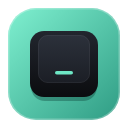
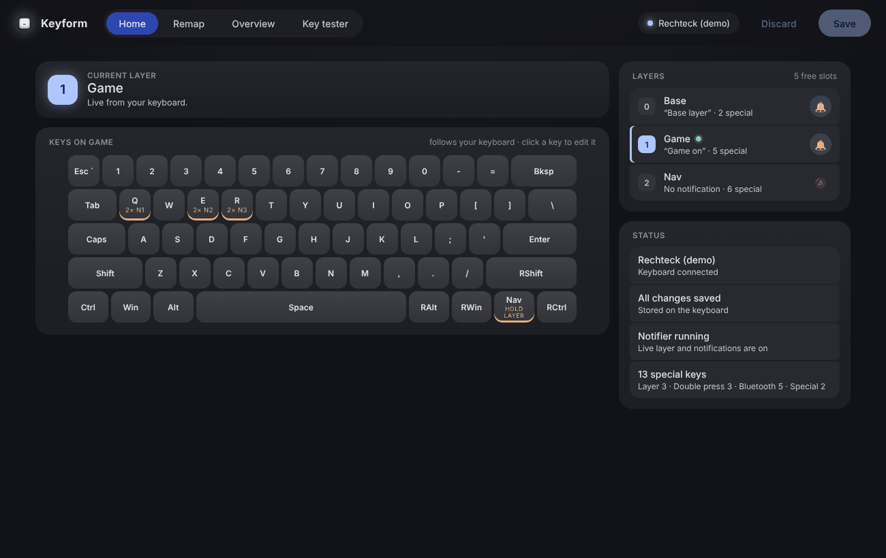
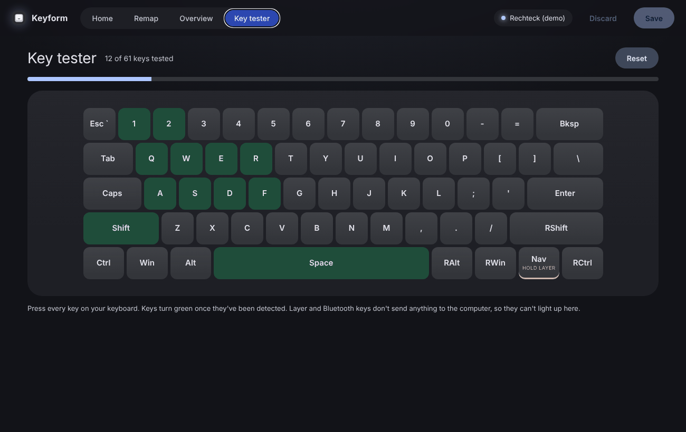

<p align="center">
  
</p>

<h1 align="center">Keyform</h1>

<p align="center">
  A clean, simple keymap editor for <a href="https://zmk.dev">ZMK</a> keyboards with ZMK Studio enabled.<br>
  Remap keys, manage layers and test every switch, live over USB, with no reflashing.<br>
  One HTML file. Nothing to install.
</p>

<p align="center">
  
</p>

---

## Features

- **Visual remapping.** Click a key, pick what it does from tabs (Keys, Media, Layers, Bluetooth, Special, Advanced) instead of dropdowns. Add Ctrl/Shift/Alt/Win for shortcuts like Ctrl + C.
- **Layers.** Add, rename, reorder and remove layers. Empty keys show what the layer below does, greyed out.
- **Duplicate and copy layers.** *Duplicate* makes a new layer with all the keys of the current one, placed right after it. *Copy keys from…* fills the current layer with another layer's keys: replace them all, or only fill the empty ones.
- **Set a key on several layers.** "Also set on" under the key editor writes your next change to the layers you pick, or to all of them, e.g. a layer toggle that works from every layer.
- **Home page with your current layer, live.** Shows which layer is on right now and follows as you switch, plus a summary of your setup. The active layer also gets a green dot in Remap. Needs the notifier (below).
- **Layer notifications.** A desktop notification when you switch layer, with per-layer on/off and your own message (🔔 Notify next to the layer buttons). Linux, with the included notifier and firmware.
- **Fn works on every layer.** Hold layers (like Nav) are kept at the end of the list automatically, so holding Fn always gives you Nav, whatever layer is on.
- **Tap-hold keys.** Layer-Tap and Mod-Tap ("tap for Z, hold for Shift") through the Advanced tab.
- **Game Mod-Tap.** Advanced → Game Mod-Tap: a Mod-Tap whose taps games actually register. Normal Mod-Tap sends a tap for about 1 ms, which games that check the keyboard once per frame often miss. Game Mod-Tap holds the tap key down for a set time, and every setting is per key: tap length (off–100 ms), hold delay (100–500 ms), hold rule, instant hold and tap-then-hold repeat, plus presets and "use this timing on all Game Mod-Tap keys". Needs the included firmware.
- **Fits any window.** On wide windows the key editor sits beside the keyboard; on narrow ones it sits below, and the keyboard shrinks to leave it room. Only the editor's contents scroll. Small windows get compact sizes by themselves (**Size** button in the top bar: Auto / Compact / Roomy), and **Hide keyboard** gives the editor the whole window.
- **Double-tap keys.** Advanced → Double Tap: pick a key for a single tap and one for a double tap (e.g. Q / Numpad 1), plus how long it waits for a second tap (slider, 150–300 ms in steps of 5, default 200), on any key and layer. Needs the included firmware.
- **Overview.** A list of every key that does more than type one character, on every layer, with a small map showing where it sits. Click a row to edit it. A search box finds keys by what they do, their name, layer or position.
- **Live keys.** Keys light up as you press them, including keys on other layers (dashed outline) and the layer key that got you there.
- **Key tester.** Press every key and watch them turn green, handy after swapping switches.
- **Auto-connect.** After picking the keyboard once, Keyform reconnects by itself (Chrome/Edge; see the Firefox note).
- **Demo mode.** Try everything without a keyboard plugged in.
- **Fully offline.** No servers, no tracking, nothing downloaded. Your keymap goes straight from the page to the keyboard over USB.

| Home (live layer) | Overview | Key tester |
|---|---|---|
|  |  |  |

---

## Quick start

1. Download **`keyform.html`** (or the whole repository: green **Code** button → **Download ZIP**).
2. Open it in **Chrome**, **Edge** or **Firefox 151+** on a computer.
3. Plug the keyboard in with a **USB cable**.
4. Click **Connect keyboard** and pick it from the list.
5. Change keys, then click **Save** to store the changes on the keyboard.

> Close zmk.studio (website or app) first. Only one program can talk to the keyboard at a time.

### Browser support

| Browser | Works | Notes |
|---|---|---|
| Chrome / Edge / other Chromium | ✅ | Remembers the keyboard, so auto-connect works even from a local file |
| Firefox 151+ (desktop) | ✅ | Local files only get *temporary* permission, so you pick the keyboard each time. Host it (see below) to make it stick |
| Safari, any phone browser | ❌ | No USB (Web Serial) support |

---

## Match your desktop colours (DMS / matugen)

Keyform can follow your desktop theme: new wallpaper or light/dark switch in DMS (Dux Modular Shell), and Keyform matches next time you open it. Without this it uses its built-in blue.

`./linux/install.sh` sets this up. It adds a small template to matugen (the colour tool behind DMS's theming). When your theme changes, matugen writes the colours to `keyform-theme.css` and runs `keyform-apply-theme`, which copies them into your installed `keyform.html` itself, so it works in any browser, Flatpak ones included. Change your wallpaper or theme in DMS once to create it. To keep the built-in colours instead: `./linux/install.sh --no-theme`.

If the file doesn't appear after a theme change, DMS may not be running your own matugen templates. Look for a "user templates" or "matugen templates" option in DMS's Wallpaper & colors settings.

## Layer notifications (Linux)

The firmware quietly tells the computer which layer is on (using a reserved key code that nothing types), and a small background program shows a notification.

1. Flash the firmware in `firmware/` (it includes the layer report).
2. Run `./linux/install.sh` (it installs the notifier along with the app). The notifier runs in the background and starts at every login. It needs no extra software, only Python 3 and `notify-send`, which most desktops have.
3. It needs permission to read the keyboard. This udev rule covers USB and Bluetooth. Put it in `/etc/udev/rules.d/70-zmk-keyboard.rules` (or your image), then unplug and replug the keyboard:
   ```
   SUBSYSTEM=="tty", ATTRS{idVendor}=="1d50", ATTRS{idProduct}=="615e", TAG+="uaccess"
   KERNEL=="hidraw*", KERNELS=="*:1D50:615E.*", TAG+="uaccess"
   ```
4. In Keyform (opened from the app menu), pick a layer, click **🔔 Notify** and choose whether it notifies and what it says. Changes reach the notifier by themselves. If the notifier isn't running, **Save notifier settings** puts a file in Downloads instead; the notifier takes it later and deletes it, so nothing piles up.

The notifier also shares the current layer with Keyform over a private link on your own PC (`http://127.0.0.1:47811`, not reachable from other devices). Keyform uses it for the live Home page and sends notification settings back over it.

Safety and resources:
- The link needs a secret key that the installer creates once (`~/.config/keyform/token`, readable only by you) and writes into your installed Keyform. Websites and other programs don't have it, so they can't read your layer or change settings.
- Settings are checked strictly before use: unknown fields are dropped, text is shortened and cleaned, and messages are passed to `notify-send` without a shell, so they can never run a command.
- The notifier sleeps until the keyboard sends something, looks for a missing keyboard every 3 seconds (once a minute when it's found), and only rereads its settings when the file changed. Keyform retries the link with growing pauses, up to once a minute, when the notifier isn't running.

Extras: `keyform-notify --test 2` shows layer 2's notification, and `keyform-notify --devices` checks that it finds the keyboard. The current layer is also written to `$XDG_RUNTIME_DIR/keyform-layer` for status bars (Waybar etc.). To leave it out: `./linux/install.sh --no-notifier`.

---

## Setting up on a new PC

1. Download this repository (green **Code** button → **Download ZIP**) and unzip it, or:
   ```bash
   git clone https://github.com/<your-username>/keyform.git
   ```
2. **Linux:** add Keyform to your app menu with the included installer:
   ```bash
   cd keyform
   ./linux/install.sh            # app, launcher, icons, notifier and theme following, in ~/Keyform
   # or: ./linux/install.sh ~/Keyboard   to choose another folder
   # skip parts with --no-notifier and/or --no-theme
   ```
   Then search for **Keyform** in your app menu. Run the same command again after every update: it replaces the previous install instead of adding to it, and keeps your notification settings. To remove everything: `./linux/uninstall.sh` (add `--all` to remove your settings too, leaving nothing behind).

   If Chromium, Chrome, Brave or Edge is installed, the launcher opens Keyform in its own app window, with the Keyform icon in your dock and window switcher. Otherwise it opens as a tab in your default browser.

   The app is installed into a normal folder on purpose. Snap and Flatpak browsers can't open files inside hidden folders like `~/.local`.
3. **Windows / macOS:** keep `keyform.html` somewhere permanent (e.g. `Documents/Keyform`), open it once and bookmark it.
4. Open Keyform, connect the keyboard once, and you're set.

### Optional: use it from a web address (GitHub Pages)

Handy if you use Firefox (permission is remembered for real websites) or want Keyform on any computer without downloading anything.

1. Make the repository public (Settings → General → Danger Zone). Pages is free for public repositories.
2. **Settings → Pages → Source: GitHub Actions.** Leave *Custom domain* empty.
3. Push to `main` (or Actions → **Publish Keyform** → **Run workflow**). The workflow in `.github/workflows/pages.yml` publishes `keyform.html`, and every run shows up in the Actions tab.
4. Keyform is then at `https://<your-username>.github.io/keyform/`.

Your keymap never touches GitHub. The page just runs in your browser and talks to the keyboard over USB. The live layer and your desktop colours only work in the installed copy (app menu), which holds the notifier key and your theme.

---

## Keyboard firmware (Boardsource Rechteck)

`firmware/` holds a backup of the firmware this keyboard runs, so a new PC (or a reset keyboard) is easy to set up.

| File | What it is |
|---|---|
| `rechteck-zmk-studio.uf2` | **Current firmware.** ZMK v0.3 with Studio enabled, unlock key off, 6 spare layers for Studio/Keyform, and the Double Tap and Game Mod-Tap add-ons |
| `rechteck-zmk-studio-before-gamemodtap.uf2` | The same without Game Mod-Tap. Flash this to go back if Game Mod-Tap gives trouble |
| `rechteck-zmk-studio-before-doubletap.uf2` | Without Double Tap and Game Mod-Tap |
| `rechteck-zmk-studio-old-2layers.uf2` | Previous version (only Base + Nav, no spare layers). Fallback if needed |
| `zmk-config/` | The source files the firmware is built from |

### Flashing the firmware

1. Take off the **spacebar** keycap. The **RST** button is in the cut-out next to "Powered by ZMK", left of the spacebar switch.
2. Plug the keyboard in with USB.
3. **Double-tap RST.** A drive appears, like a USB stick.
4. Drag the `.uf2` file onto it. The drive disappears and the keyboard restarts. An error saying the drive was removed is normal.
5. Put the spacebar back on.

Changes you saved in Keyform or Studio normally survive a firmware update, but take screenshots of your layers first to be safe.

### Rebuilding the firmware

`zmk-config/` is a ready-made ZMK config. To build new firmware yourself, for example with more spare layers:

1. Create a **separate** GitHub repository and upload the *contents* of `firmware/zmk-config/` to it, including the hidden `.github` folder.
2. Edit the files (see the README inside that folder).
3. GitHub builds automatically: **Actions** tab → latest run → download **firmware** → `.uf2` inside.

---

## Troubleshooting

| Problem | Fix |
|---|---|
| Keyboard doesn't appear in the list | Use a data USB cable (not charge-only) and close zmk.studio and other Keyform tabs |
| "Could not open the keyboard" | Another program has it open. Close zmk.studio and other Keyform tabs, then try again |
| Auto-connect doesn't work in Firefox | Expected for local files. Host it on GitHub Pages, use Chrome/Edge, or click Connect |
| App menu launcher does nothing | The launcher points to the wrong place. Run `./linux/install.sh` again |
| The Fn/layer key doesn't light up | Normal. Layer keys send nothing to the computer until you press another key with them |
| "Add layer" is greyed out | No spare layers left in the firmware. Rebuild with more reserved layers |
| A game misses Mod-Tap taps | Use Advanced → Game Mod-Tap instead of Mod-Tap. Still missed? Raise Tap length (40–50 ms) |
| No Game Mod-Tap in the Advanced list | The keyboard runs older firmware. Flash `firmware/rechteck-zmk-studio.uf2` |
| Keyboard says it's locked | Press the Studio unlock key (this firmware has the lock turned off) |

---

## Building Keyform from source

`keyform.html` is generated from the code in `source/`. You only need this if you want to change Keyform itself.

Requirements: [Node.js](https://nodejs.org) 18 or newer.

```bash
cd source
npm install
npm run build      # writes ../keyform.html
```

| File | What it does |
|---|---|
| `src/index.html` | Page layout (header, start screen, editor, overview, tester) |
| `src/style.css` | All styling. Colours are at the top as `--accent`, `--bg` etc. |
| `src/app.js` | Interface: drawing the keyboard, key picker, layers, overview, live keys |
| `src/device.js` | Talking to the keyboard (ZMK Studio over Web Serial), plus the demo keyboard |
| `src/hid.js` | Key names and codes (letters, F-keys, media keys…) |
| `src/demo-data.js` | The Rechteck layout used by demo mode |
| `build.mjs` | Bundles everything into a single HTML file with esbuild |

Open `keyform.html?demo` to try changes without a keyboard.

---

## Limits

- Combos and macros can't be *created* from Keyform or ZMK Studio. They need a firmware change. Existing ones do show up in the Overview.
- Double tap works through the Double Tap add-on in `firmware/zmk-config` (normal ZMK can't set double taps from an app). After a single tap it waits for a possible second tap (150–300 ms, set with the slider) before sending the key.
- Game Mod-Tap works through the Game Mod-Tap add-on in `firmware/zmk-config`. Its settings are stored inside the key, so zmk.studio shows them as one number ("Settings"); change them in Keyform.
- Keyform can only change what the keyboard's firmware allows through ZMK Studio.

## Credits

Built on the official [ZMK Studio client library](https://github.com/zmkfirmware/zmk-studio-ts-client). See [THIRD_PARTY_NOTICES.md](THIRD_PARTY_NOTICES.md) for the open-source libraries included. Keyform is an independent project, not affiliated with ZMK or Boardsource.
