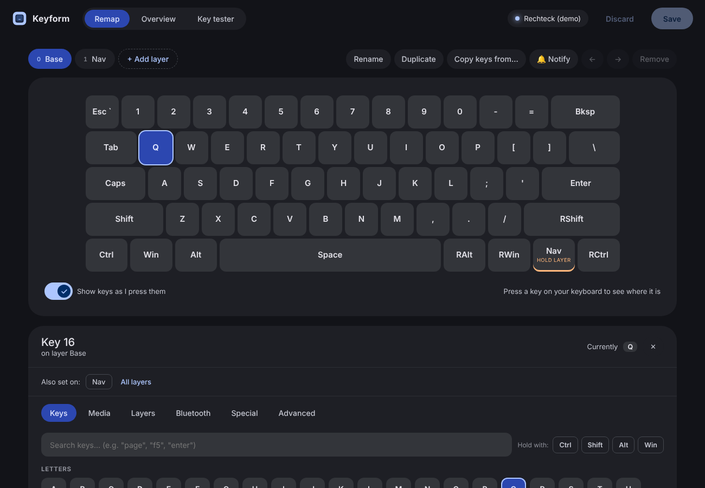
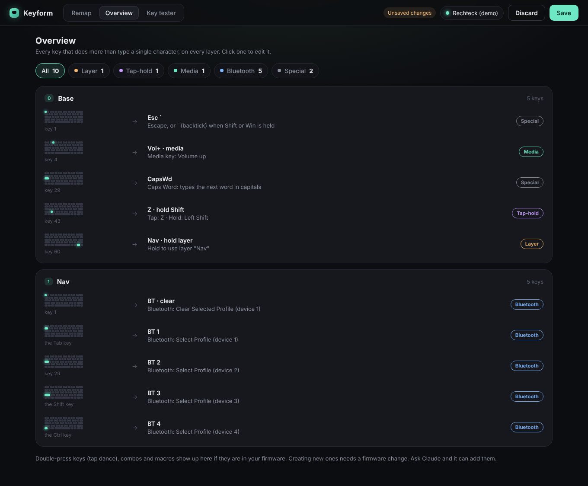

<p align="center">
  
</p>

<h1 align="center">Keyform</h1>

<p align="center">
  A clean, simple keymap editor for <a href="https://zmk.dev">ZMK</a> keyboards with ZMK Studio enabled.<br>
  Remap keys, manage layers and test every switch, live over USB, with no reflashing.<br>
  One HTML file. Nothing to install.
</p>

<p align="center">
  
</p>

---

## Features

- **Visual remapping.** Click a key, pick what it does from tabs (Keys, Media, Layers, Bluetooth, Special, Advanced) instead of dropdowns. Add Ctrl/Shift/Alt/Win for shortcuts like Ctrl + C.
- **Layers.** Add, rename, reorder and remove layers. Empty keys show what the layer below does, greyed out.
- **Tap-hold keys.** Layer-Tap and Mod-Tap ("tap for Z, hold for Shift") through the Advanced tab.
- **Overview.** A list of every key that does more than type one character, on every layer, with a small map showing where it sits. Click a row to edit it.
- **Live keys.** Keys light up as you press them, including keys on other layers (dashed outline) and the layer key that got you there.
- **Key tester.** Press every key and watch them turn green, handy after swapping switches.
- **Auto-connect.** After picking the keyboard once, Keyform reconnects by itself (Chrome/Edge; see the Firefox note).
- **Demo mode.** Try everything without a keyboard plugged in.
- **Fully offline.** No servers, no tracking, nothing downloaded. Your keymap goes straight from the page to the keyboard over USB.

| Overview | Key tester |
|---|---|
|  |  |

---

## Quick start

1. Download **`keyform.html`** (or the whole repository: green **Code** button → **Download ZIP**).
2. Open it in **Chrome**, **Edge** or **Firefox 151+** on a computer.
3. Plug the keyboard in with a **USB cable**.
4. Click **Connect keyboard** and pick it from the list.
5. Change keys, then click **Save** to store the changes on the keyboard.

> Close zmk.studio (website or app) first. Only one program can talk to the keyboard at a time.

### Browser support

| Browser | Works | Notes |
|---|---|---|
| Chrome / Edge / other Chromium | ✅ | Remembers the keyboard, so auto-connect works even from a local file |
| Firefox 151+ (desktop) | ✅ | Local files only get *temporary* permission, so you pick the keyboard each time. Host it (see below) to make it stick |
| Safari, any phone browser | ❌ | No USB (Web Serial) support |

---

## Setting up on a new PC

1. Download this repository (green **Code** button → **Download ZIP**) and unzip it, or:
   ```bash
   git clone https://github.com/<your-username>/keyform.git
   ```
2. **Linux:** add Keyform to your app menu with the included installer:
   ```bash
   cd keyform
   ./linux/install.sh            # puts the app in ~/Keyform
   # or: ./linux/install.sh ~/Keyboard   to choose another folder
   ```
   Then search for **Keyform** in your app menu. To remove the launcher again: `./linux/uninstall.sh`.

   The app is installed into a normal folder on purpose. Snap and Flatpak browsers can't open files inside hidden folders like `~/.local`.
3. **Windows / macOS:** keep `keyform.html` somewhere permanent (e.g. `Documents/Keyform`), open it once and bookmark it.
4. Open Keyform, connect the keyboard once, and you're set.

### Optional: use it from a web address (GitHub Pages)

Handy if you use Firefox (permission is remembered for real websites) or want Keyform on any computer without downloading anything.

1. In this repository on GitHub: **Settings → Pages**.
2. Source: **Deploy from a branch**, branch **main**, folder **/ (root)**, then **Save**.
3. After a minute it's live at `https://<your-username>.github.io/keyform/`.

Your keymap never touches GitHub. The page just runs in your browser and talks to the keyboard over USB.

---

## Keyboard firmware (Boardsource Rechteck)

`firmware/` holds a backup of the firmware this keyboard runs, so a new PC (or a reset keyboard) is easy to set up.

| File | What it is |
|---|---|
| `rechteck-zmk-studio.uf2` | **Current firmware.** ZMK v0.3 with Studio enabled, unlock key off, 6 spare layers for Studio/Keyform |
| `rechteck-zmk-studio-old-2layers.uf2` | Previous version (only Base + Nav, no spare layers). Fallback if needed |
| `zmk-config/` | The source files the firmware is built from |

### Flashing the firmware

1. Take off the **spacebar** keycap. The **RST** button is in the cut-out next to "Powered by ZMK", left of the spacebar switch.
2. Plug the keyboard in with USB.
3. **Double-tap RST.** A drive appears, like a USB stick.
4. Drag the `.uf2` file onto it. The drive disappears and the keyboard restarts. An error saying the drive was removed is normal.
5. Put the spacebar back on.

Changes you saved in Keyform or Studio normally survive a firmware update, but take screenshots of your layers first to be safe.

### Rebuilding the firmware

`zmk-config/` is a ready-made ZMK config. To build new firmware yourself, for example with more spare layers:

1. Create a **separate** GitHub repository and upload the *contents* of `firmware/zmk-config/` to it, including the hidden `.github` folder.
2. Edit the files (see the README inside that folder).
3. GitHub builds automatically: **Actions** tab → latest run → download **firmware** → `.uf2` inside.

---

## Troubleshooting

| Problem | Fix |
|---|---|
| Keyboard doesn't appear in the list | Use a data USB cable (not charge-only) and close zmk.studio and other Keyform tabs |
| "Could not open the keyboard" | Another program has it open. Close zmk.studio and other Keyform tabs, then try again |
| Auto-connect doesn't work in Firefox | Expected for local files. Host it on GitHub Pages, use Chrome/Edge, or click Connect |
| App menu launcher does nothing | The launcher points to the wrong place. Run `./linux/install.sh` again |
| The Fn/layer key doesn't light up | Normal. Layer keys send nothing to the computer until you press another key with them |
| "Add layer" is greyed out | No spare layers left in the firmware. Rebuild with more reserved layers |
| Keyboard says it's locked | Press the Studio unlock key (this firmware has the lock turned off) |

---

## Building Keyform from source

`keyform.html` is generated from the code in `source/`. You only need this if you want to change Keyform itself.

Requirements: [Node.js](https://nodejs.org) 18 or newer.

```bash
cd source
npm install
npm run build      # writes ../keyform.html
```

| File | What it does |
|---|---|
| `src/index.html` | Page layout (header, start screen, editor, overview, tester) |
| `src/style.css` | All styling. Colours are at the top as `--accent`, `--bg` etc. |
| `src/app.js` | Interface: drawing the keyboard, key picker, layers, overview, live keys |
| `src/device.js` | Talking to the keyboard (ZMK Studio over Web Serial), plus the demo keyboard |
| `src/hid.js` | Key names and codes (letters, F-keys, media keys…) |
| `src/demo-data.js` | The Rechteck layout used by demo mode |
| `build.mjs` | Bundles everything into a single HTML file with esbuild |

Open `keyform.html?demo` to try changes without a keyboard.

---

## Limits

- Combos, macros and tap-dance ("double press") keys can't be *created* from Keyform or ZMK Studio. They need a firmware change. Existing ones do show up in the Overview.
- Keyform can only change what the keyboard's firmware allows through ZMK Studio.

## Credits

Built on the official [ZMK Studio client library](https://github.com/zmkfirmware/zmk-studio-ts-client). See [THIRD_PARTY_NOTICES.md](THIRD_PARTY_NOTICES.md) for the open-source libraries included. Keyform is an independent project, not affiliated with ZMK or Boardsource.
